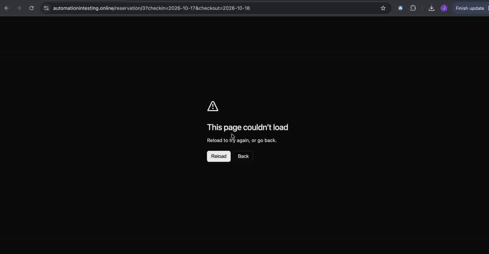
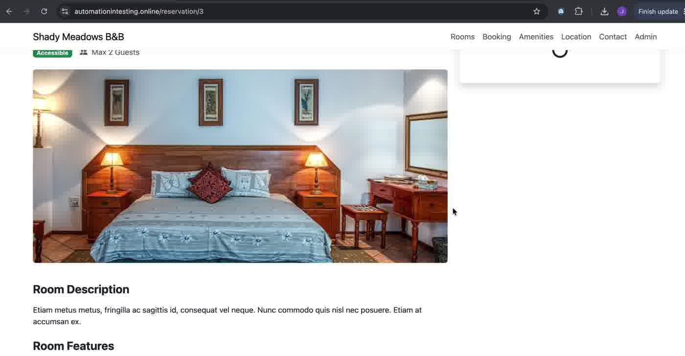

# BUG-01 · Booking panel crashes when the server rejects a booking

| Field | Value |
|---|---|
| Severity | High |
| Priority | High |
| Component | Room page → "Book This Room" panel |
| Environment | https://automationintesting.online · Google Chrome on macOS |
| Reproducibility | Always (3 different paths, see below) |
| Related AC | AC10 (already-booked dates), AC11 (Check Out after Check In) |
| Found by | Exploratory testing (paths A and B); path C from AI-generated test case v2 TC-030 |
| Date | 2026-10-17, path C on 2026-10-19 |

## Summary

When the booking request is rejected (dates already taken, or an invalid date range), the app doesn't show a message. The browser shows "This page couldn't load". After reloading, the URL loses the dates and the booking panel shows a loading spinner indefinitely. The user gets no explanation and can't continue from that page.

## Steps to reproduce

**Path A: dates already booked**
1. Open `https://automationintesting.online/reservation/3?checkin=2026-10-17&checkout=2026-10-18` (Suite).
2. Click "Reserve Now", enter valid data (Firstname `John`, Lastname `Doe`, Email `test@test.com`, Phone `12312322222`), click "Reserve Now". Result: "Booking Confirmed".
3. Open the same URL again right away.
4. Click "Reserve Now", enter valid data, click "Reserve Now".

**Path B: Check Out before Check In**
1. On the home page, set Check In `17/10/2026` and Check Out `02/10/2026`, click "Check Availability".
2. Click "Book now" on the Double room.
3. Click "Reserve Now", enter valid data, click "Reserve Now".

**Path C: Check Out equal to Check In**
1. On the home page, set Check In and Check Out to `22/10/2026`, click "Check Availability".
2. Click "Book now" on the Double room.
3. Click "Reserve Now", enter valid data, click "Reserve Now".

## Expected result

The booking is not created. A clear message explains why (for example "These dates are not available" or "Check Out must be after Check In"). The page stays usable so the user can choose other dates.

## Actual result

- The browser shows "This page couldn't load" with Reload / Back.
- After Reload, the URL is `/reservation/{roomId}` without the date parameters, and the "Book This Room" panel shows a spinner that never finishes.
- No message explains what happened.

## Evidence

| Path | Screenshot |
|---|---|
| A: second booking of the same Suite dates |  |
| A: after reload, URL without dates and panel stuck loading |  |
| B: Check Out before Check In |  |
| C: same-day booking |  |

## Notes

- Likely cause (hypothesis, not confirmed): the backend correctly rejects the booking, but the frontend doesn't handle the error response.
- Path B and C also show a wrong price before submitting (see BUG-02).
- Not caused by the demo's data reset: path A was repeated immediately after a confirmed booking.
