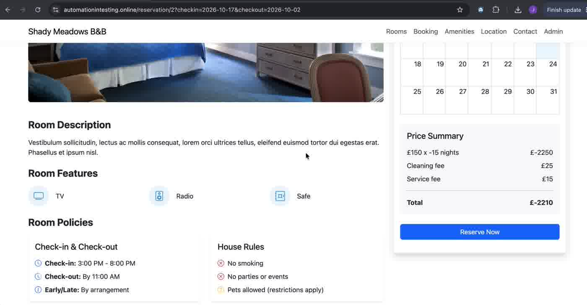
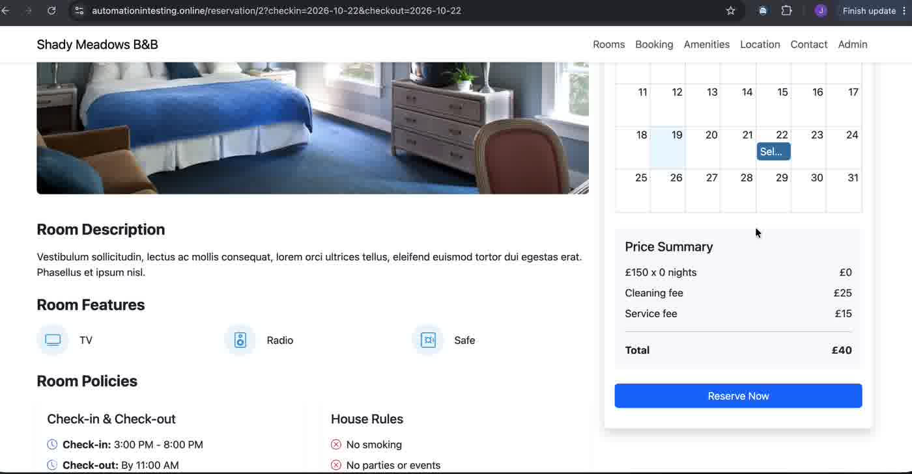

# BUG-02 · Invalid date range is not validated: price shows negative or zero nights

| Field | Value |
|---|---|
| Severity | High |
| Priority | High |
| Component | Home page date fields → room page Price Summary |
| Environment | https://automationintesting.online · Google Chrome on macOS |
| Reproducibility | Always |
| Related AC | AC11 (Check Out after Check In), AC2 (price summary) |
| Found by | Exploratory testing (negative nights); zero-night variant from AI-generated test case v2 TC-030 |
| Date | 2026-10-17, zero-night variant on 2026-10-19 |

## Summary

The home page accepts a Check Out date that is before or equal to the Check In date, with no warning. The room page then calculates the price from that range: negative nights give a negative total, and zero nights give a total made only of the fees.

## Steps to reproduce

**Variant A: Check Out before Check In**
1. On the home page, set Check In `17/10/2026` and Check Out `02/10/2026`.
2. Click "Check Availability".
3. Click "Book now" on the Double room.
4. Read the Price Summary.

**Variant B: Check Out equal to Check In**
1. On the home page, set Check In and Check Out to `22/10/2026`.
2. Click "Check Availability".
3. Click "Book now" on the Double room.
4. Read the Price Summary.

## Expected result

The home page rejects the range with a clear message (or the date picker prevents it). The room page never shows zero or negative nights or a total for an invalid range.

## Actual result

- Variant A: "£150 x -15 nights = £-2250", Cleaning fee £25, Service fee £15, **Total £-2210**. With Check Out `01/10/2026`: -16 nights, Total £-2360.
- Variant B: "£150 x 0 nights = £0", Cleaning fee £25, Service fee £15, **Total £40**.
- In both variants, "Reserve Now" stays available; submitting crashes the page (BUG-01).

## Evidence

| Variant | Screenshot |
|---|---|
| A: negative nights and total |  |
| B: zero nights, £40 total |  |

## Notes

- The room page computes the price from the URL parameters (`?checkin=2026-10-17&checkout=2026-10-02`) without validating them, so the room page is missing the check too, not only the home page.
