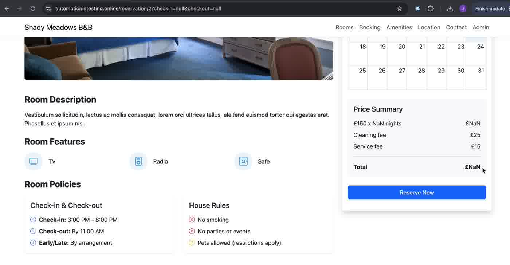
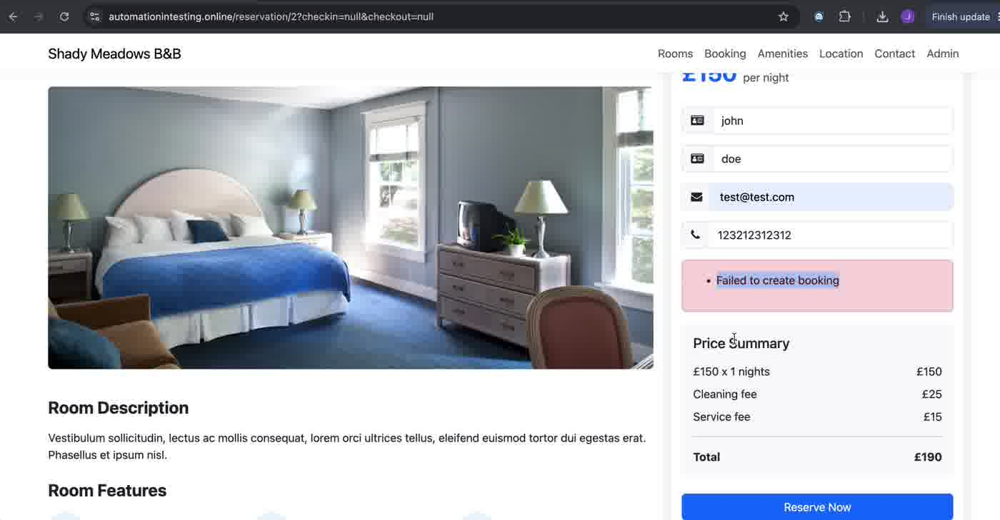

# BUG-03 · "View Details" in Similar Rooms loses the selected dates (£NaN, booking fails)

| Field | Value |
|---|---|
| Severity | Medium |
| Priority | Medium |
| Component | Room page → "Similar Rooms You Might Like" |
| Environment | https://automationintesting.online · Google Chrome on macOS |
| Reproducibility | Always |
| Related AC | AC12 (reaching a room from any path keeps the dates or asks for them) |
| Found by | Exploratory testing |
| Date | 2026-10-17 |

## Summary

From a room page with dates selected, "View Details" on a similar room opens it with `checkin=null&checkout=null`. The Price Summary shows "NaN", and submitting a booking fails with a generic message.

## Steps to reproduce

1. Open `https://automationintesting.online/reservation/3?checkin=2026-10-17&checkout=2026-10-18` (Suite).
2. Scroll to "Similar Rooms You Might Like".
3. On the Double card, click "View Details".
4. Check the URL and the Price Summary.
5. Click "Reserve Now", enter valid data, click "Reserve Now".

## Expected result

The Double room opens with the same dates (17–18 October), or the page asks the user to select dates before booking.

## Actual result

- URL: `/reservation/2?checkin=null&checkout=null`.
- Price Summary: "£150 x NaN nights = £NaN", Total £NaN.
- After opening the form, the summary changes to "1 nights, £190" with no dates selected.
- Submitting shows "Failed to create booking" in the red error box.

## Evidence

| Step | Screenshot |
|---|---|
| URL with null dates, £NaN |  |
| "Failed to create booking" |  |
