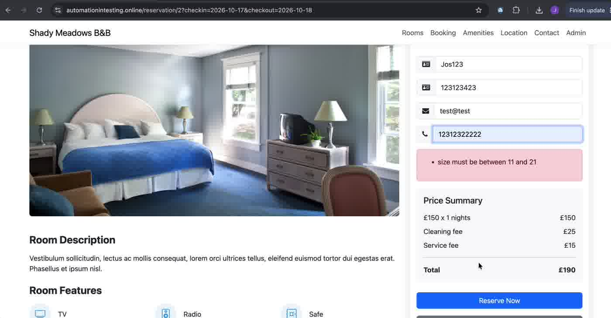
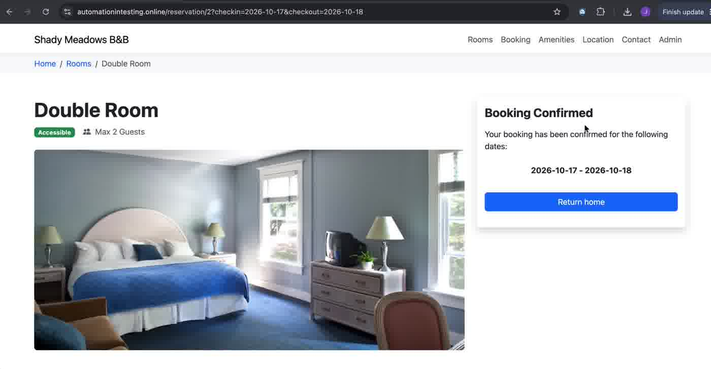

# BUG-04 · First and last name accept values made only of digits

| Field | Value |
|---|---|
| Severity | Medium |
| Priority | Low (needs product decision) |
| Component | Booking form → Firstname, Lastname |
| Environment | https://automationintesting.online · Google Chrome on macOS |
| Reproducibility | Always |
| Related AC | AC4, AC5 (define length only) |
| Found by | Exploratory testing |
| Date | 2026-10-17 |

## Summary

The name fields only check length (Firstname 3–18, Lastname 3–30). A booking is confirmed with a first name that contains digits and a last name made only of digits.

## Steps to reproduce

1. Open `https://automationintesting.online/reservation/2?checkin=2026-10-17&checkout=2026-10-18` (Double).
2. Click "Reserve Now".
3. Enter Firstname `Jos123`, Lastname `123123423`, Email `test@test`, Phone `12312322222`.
4. Click "Reserve Now".

## Expected result

Names made only of digits are rejected with a clear message. (No acceptance criterion defines allowed characters, so this needs a product decision. Real names with accents, apostrophes and hyphens, such as `José O'Brien-Núñez`, must still be accepted.)

## Actual result

"Booking Confirmed" for 2026-10-17 - 2026-10-18.

## Evidence

| Step | Screenshot |
|---|---|
| Form values just before the final submit (the red box is left over from the previous attempt with a 10-digit phone) |  |
| Confirmation |  |

## Notes

- The same booking also used `test@test` as email, which the app accepts. It is technically a valid format, so it's recorded as an observation, not part of this bug.
- Logged as a question for the product owner: should names allow digits at all?
