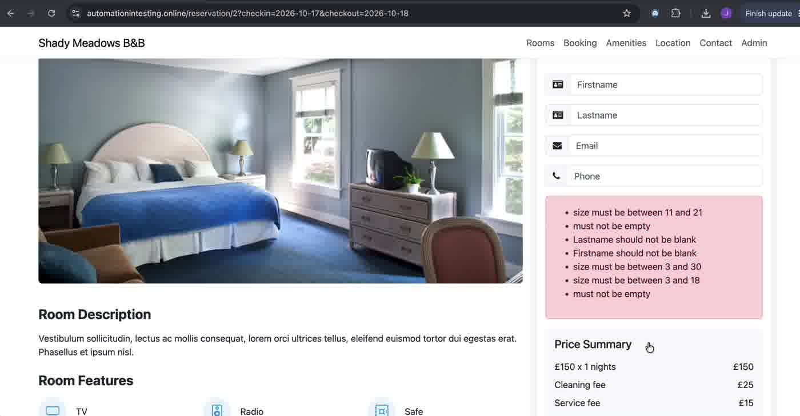

# BUG-05 · Validation messages don't name the field; generic failure message

| Field | Value |
|---|---|
| Severity | Low |
| Priority | Medium |
| Component | Booking form → error box |
| Environment | https://automationintesting.online · Google Chrome on macOS |
| Reproducibility | Always |
| Related AC | AC8 (invalid fields show error messages) |
| Found by | Exploratory testing |
| Date | 2026-10-17 |

## Summary

Several validation messages don't say which field they refer to, and their format is inconsistent. With all fields empty, the user sees two identical "must not be empty" messages and two "size must be between…" messages without field names.

## Steps to reproduce

1. Open any room page with valid dates, for example `https://automationintesting.online/reservation/2?checkin=2026-10-17&checkout=2026-10-18`.
2. Click "Reserve Now".
3. Leave all fields empty and click "Reserve Now".
4. Separately, enter valid values except Phone `1231232222` (10 digits) and click "Reserve Now".

## Expected result

Each message names the field and the rule, for example "Phone must be between 11 and 21 characters". Messages use a consistent format.

## Actual result

- Step 3 shows 7 messages: "size must be between 11 and 21", "must not be empty", "Lastname should not be blank", "Firstname should not be blank", "size must be between 3 and 30", "size must be between 3 and 18", "must not be empty".
- Step 4 shows only "size must be between 11 and 21".
- When a booking fails for other reasons (see BUG-03), the message is "Failed to create booking" with no cause.

## Evidence

| Step | Screenshot |
|---|---|
| All fields empty: 7 messages |  |

## Notes

- The wording ("size must be between…", "must not be empty") looks like default server-side validation messages passed through to the UI.
