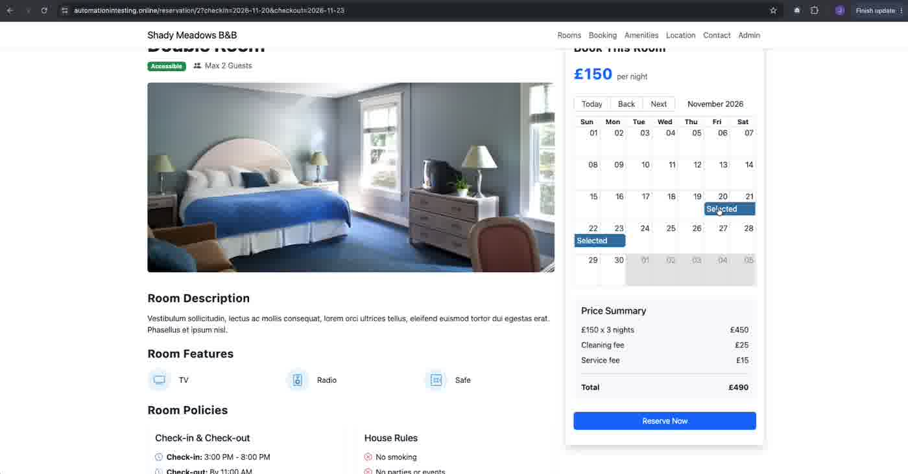
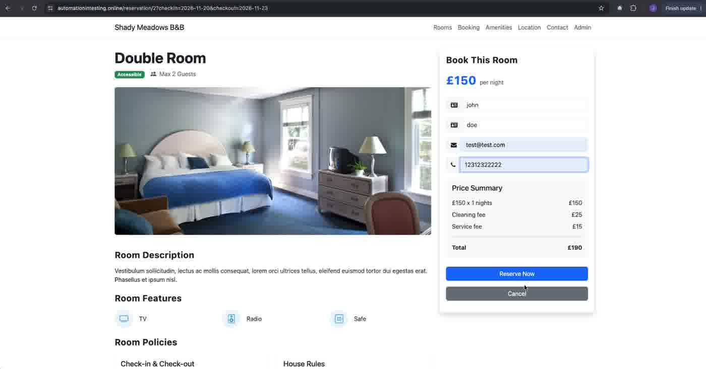
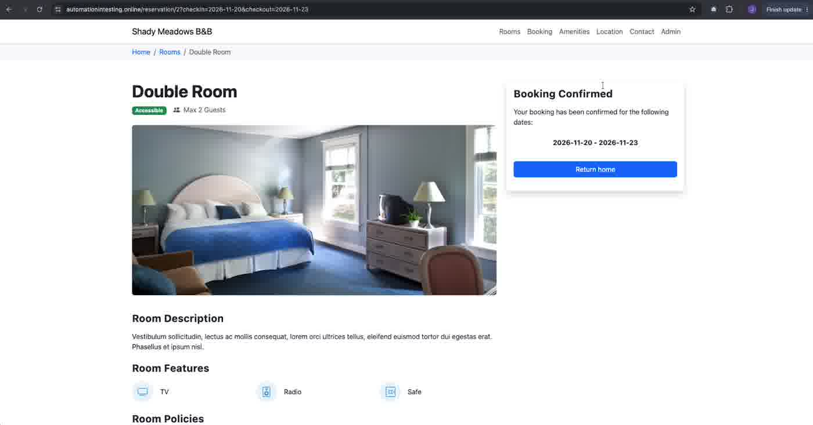

# BUG-06 · Clicking a date in the room calendar lowers the displayed price, but the original range is booked

| Field | Value |
|---|---|
| Severity | High |
| Priority | High |
| Component | Room page → "Book This Room" calendar and Price Summary |
| Environment | https://automationintesting.online · Google Chrome on macOS |
| Reproducibility | Always (reproduced on Single and Double) |
| Related AC | AC1 (the dates chosen are the dates booked), AC2 (price summary) |
| Found by | Jose Serna, while verifying how the room calendar displays a selection (for the AI agent's UI map). Not found by any version of the AI-generated test cases. |
| Date | 2026-10-19 |

## Summary

On the room page, clicking a single date in the calendar changes the Price Summary to 1 night, but the calendar keeps showing the original range and the URL doesn't change. If the user submits, the original range is booked. The user sees a lower price than the stay they actually book.

## Steps to reproduce

1. Open `https://automationintesting.online/reservation/2?checkin=2026-11-20&checkout=2026-11-23` (Double, 3 nights).
2. Check the Price Summary: £150 x 3 nights = £450, Total £490.
3. In the calendar, click "Next" to show November 2026. The "Selected" bar covers 20–22 November.
4. Click a single day outside the selected range.
5. Check the Price Summary, the calendar and the URL.
6. Without reloading, click "Reserve Now", enter valid data (Firstname `john`, Lastname `doe`, Email `test@test.com`, Phone `12312322222`), click "Reserve Now".

## Expected result

Either the click changes the selection everywhere (calendar, URL, price and booking stay consistent), or clicking a date has no effect. The price shown before submitting always matches the dates that get booked.

## Actual result

- Step 5: the Price Summary changes to **£150 x 1 nights = £150, Total £190**. The "Selected" bar still covers 20–22 November, and the URL still says 20–23.
- Step 6: "Booking Confirmed" for **2026-11-20 - 2026-11-23** (3 nights, £490).
- Reloading the page restores the 3-night price.

## Evidence

| Step | Screenshot |
|---|---|
| Before the click: 3 nights, £490 |  |
| After the click: 1 night, £190, form filled |  |
| Confirmation: 20–23 November booked |  |

## Notes

- Also reproduced on the Single room (URL 15–18 November): Total changed from £340 to £140 after the click.
- Impact: in a real booking system this would show the guest a lower price than the stay being booked, or charge a different amount than displayed.
- The click updates some internal state used by the Price Summary, while the calendar display, URL and booking request use the original dates (hypothesis).
