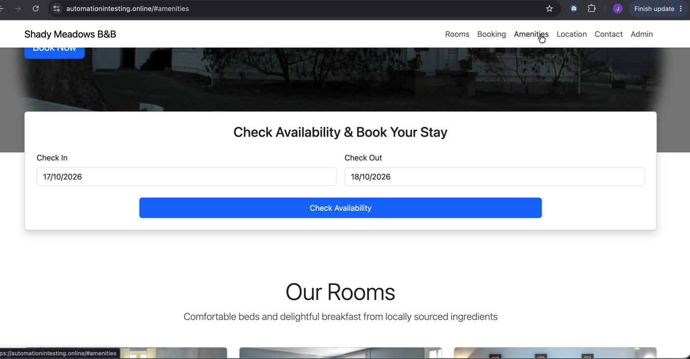

# BUG-07 · "Amenities" navigation link doesn't go to any section

| Field | Value |
|---|---|
| Severity | Low |
| Priority | Low |
| Component | Top navigation (outside the booking flow) |
| Environment | https://automationintesting.online · Google Chrome on macOS |
| Reproducibility | Always |
| Found by | Exploratory testing (Jose Serna) |
| Date | 2026-10-19 |

## Summary

Clicking "Amenities" in the top navigation changes the URL to `/#amenities`, but the page doesn't scroll anywhere. No Amenities section exists on the home page.

## Steps to reproduce

1. Open `https://automationintesting.online`.
2. Click "Amenities" in the top navigation.

## Expected result

The page scrolls to an Amenities section, or the link is removed if the section doesn't exist.

## Actual result

The URL becomes `https://automationintesting.online/#amenities`; the page position doesn't change. The other links (Rooms, Location, Contact) scroll to their sections.

## Evidence

| Step | Screenshot |
|---|---|
| URL with #amenities, no section shown |  |
